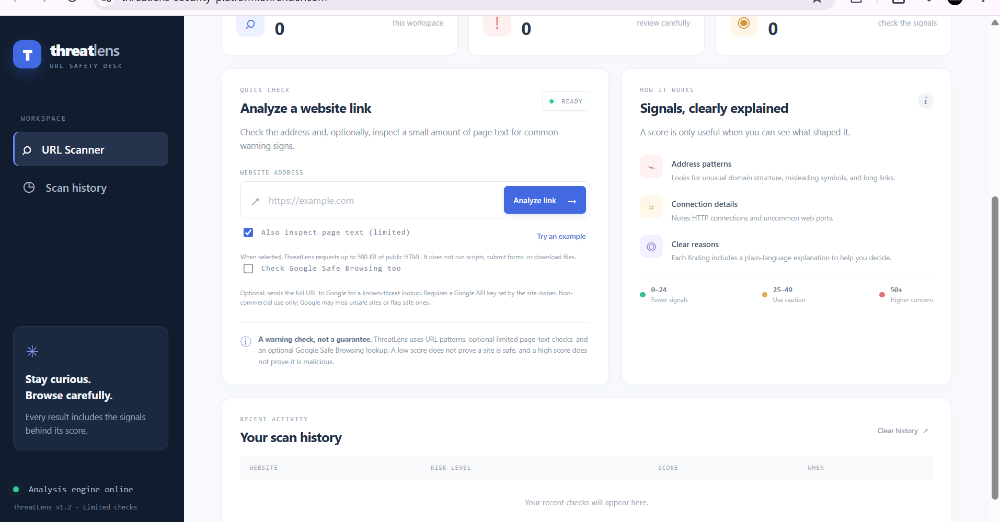
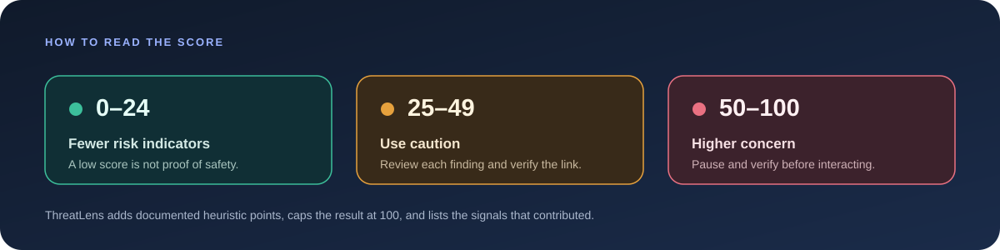
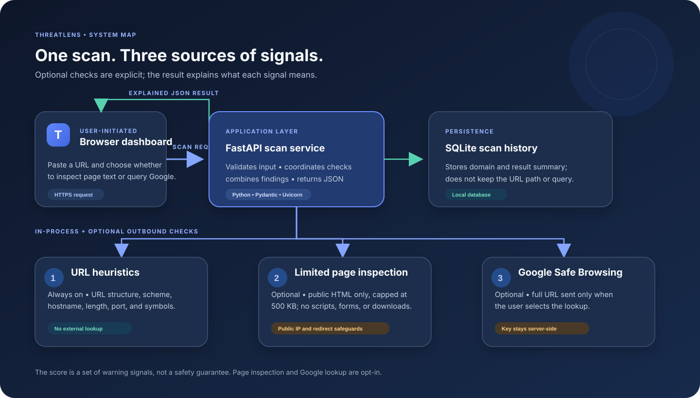

<div align="center">

# 🛡️ ThreatLens

### See the signals. Choose with confidence.

**An explainable link-checking app that combines transparent URL heuristics, optional page-text inspection, and an optional Google Safe Browsing lookup.**

<br>

[**🚀 Open the live demo**](https://threatlens-security-platform.onrender.com) &nbsp;·&nbsp; [API docs](https://threatlens-security-platform.onrender.com/docs) &nbsp;·&nbsp; [Source code](https://github.com/aqibsolangiali/threatlens-security-platform)

<br>


</div>

> [!IMPORTANT]
> ThreatLens is an educational warning tool, **not antivirus software and not a guarantee of safety**. A low score or a Google “no match” does not prove a site is safe; a high score does not prove it is malicious. Read the findings and verify important links through a trusted source.

## Start here

| Want to… | Go to… |
|---|---|
| Try the app | [Live demo](https://threatlens-security-platform.onrender.com) |
| See how results look | [Screenshots](#screenshots) |
| Run it on your computer | [Local setup](#run-locally) |
| Turn on the Google check | [Google Safe Browsing setup](#enable-google-safe-browsing) |
| Connect an API client | [API guide](#api-guide) |
| Understand privacy limits | [Privacy and security](#privacy-and-security) |

## Screenshots

<p align="center">
  
  <br><em>The scanner makes the optional checks visible before a scan starts.</em>
</p>

<p align="center">
  
  <br><em>A result shows individual signals and the Google lookup status. A no-match is not a safety certification.</em>
</p>

## What ThreatLens does

ThreatLens gives a link a **0–100 indicator score** and explains which checks contributed. A visitor chooses whether to make the two outbound checks: requesting limited HTML from the entered public site, and sending the full URL to Google Safe Browsing.

### Three kinds of signals

| Signal source | What it checks | Runs when |
|---|---|---|
| **URL analysis** | Scheme, hostname structure, encoded internationalized domain names, misleading `@`, URL length, hyphens, sensitive wording, and uncommon ports | Every scan; analyzed by the ThreatLens service |
| **Page-text inspection** | Page title and description, visible text, password inputs, cross-domain forms, automatic refreshes, embedded frames, executable/script links, and urgent credential-seeking wording | Only when **Also inspect page text (limited)** is selected |
| **Google Safe Browsing** | A Google match for the submitted URL, and the inspected final URL when applicable | Only when **Check Google Safe Browsing too** is selected and the service has a valid key |

### Risk bands

<p align="center"></p>

The score is an intentionally simple heuristic. Different checks contribute different amounts; the total is capped at 100. If Google reports a match, ThreatLens raises the score to at least 70 and shows the returned threat category. A no-match adds no assurance points.

<details>
<summary><strong>Scoring details</strong></summary>

#### URL patterns

| Finding | Points |
|---|---:|
| HTTP connection | 18 |
| Raw IP address used as the host | 20 |
| Encoded internationalized domain (`xn--`) | 22 |
| Five or more dot-separated host parts | 10 |
| `@` in the URL authority | 25 |
| URL longer than 100 characters | 8 |
| Three or more hyphens in the host | 8 |
| Sensitive wording in the host (for example, `login`, `verify`, or `password`) | 12 |
| Non-standard web port | 10 |

HTTPS is described as a positive connection signal, with an explicit note that encryption does not prove trustworthiness.

#### Page signals

| Finding | Points |
|---|---:|
| Password input found | 8 |
| Form submits to a different domain | 18 |
| Automatic page refresh/redirect marker | 8 |
| Embedded frame | 5 |
| Link to an executable or script file | 8 |
| Urgent wording or a request for credentials/recovery phrase | 14 |

The scoring rules are implemented in [`app/main.py`](app/main.py).

</details>

## How a scan travels through the app

<p align="center"></p>

1. A visitor submits a URL from the dashboard or API.
2. The service normalizes and checks the URL, then calculates the URL-pattern signals.
3. If selected, the service makes a bounded public-page request and/or asks Google Safe Browsing.
4. ThreatLens combines the findings, returns an explanation, and saves a scan summary.
5. The dashboard presents the score, each signal, optional-check statuses, and recent history.

## Technology

| Layer | Technology | Role |
|---|---|---|
| Web interface | HTML, CSS, JavaScript | Responsive scanner, opt-in controls, results, counters, and scan history |
| API | Python, FastAPI, Pydantic, Uvicorn | Request validation, analysis, page inspection, Google lookup, JSON endpoints |
| Persistence | SQLite | Lightweight scan history and summary counts |
| Reputation source | Google Safe Browsing v5 (optional) | Known-threat URL lookup, enabled with a server-side key |
| Packaging/deployment | Docker, Render | Containerized web service and public demo |
| Optional browser tool | Chrome Manifest V3 | User-clicked URL check against a local ThreatLens server |

## Run locally

### Requirements

- Python 3.10 or newer (the Docker image uses Python 3.12)
- `pip`
- Docker only if you prefer the container instructions

### 1. Get the source and create an environment

```bash
git clone https://github.com/aqibsolangiali/threatlens-security-platform.git
cd threatlens-security-platform
python -m venv .venv
```

Activate the environment:

```bash
# Windows PowerShell
.venv\Scripts\Activate.ps1

# macOS / Linux
source .venv/bin/activate
```

If PowerShell blocks activation, run `Set-ExecutionPolicy -Scope Process -ExecutionPolicy Bypass` in that PowerShell window, then activate again.

### 2. Install and start

```bash
python -m pip install -r requirements.txt
uvicorn app.main:app --reload
```

Open the dashboard at <http://127.0.0.1:8000> and the interactive API page at <http://127.0.0.1:8000/docs>.

The URL-pattern scan works without a Google key. To use the optional reputation lookup locally, set `GOOGLE_SAFE_BROWSING_API_KEY` in your shell environment before starting Uvicorn. Never paste the key into source code, the browser, screenshots, or a Git commit.

## Run with Docker

Run from the directory that contains the `Dockerfile`:

```bash
docker build -t threatlens .
docker run --rm -p 8000:8000 -v "$(pwd)/data:/data" threatlens
```

Then open <http://127.0.0.1:8000>. The container uses `THREATLENS_DB_PATH=/data/threatlens.db`; the mounted `data` folder keeps scan history after the container exits.

PowerShell volume syntax:

```powershell
docker run --rm -p 8000:8000 -v "${PWD}/data:/data" threatlens
```

## Enable Google Safe Browsing

The API key belongs to the **service owner**. People using the live scanner do not create or enter their own key.

1. In Google Cloud Console, select the project with **Safe Browsing API** enabled.
2. Go to **APIs & Services → Credentials** and create an API key.
3. Restrict the key to the **Safe Browsing API**.
4. In Render, open the web service and select **Environment**.
5. Add a variable named `GOOGLE_SAFE_BROWSING_API_KEY`; put the key in the value field.
6. Save the change and wait for Render to redeploy.
7. In ThreatLens, select **Check Google Safe Browsing too** and scan a test address.

If the card says **could not complete the check**, look in Render **Logs** for the status. Common causes include an invalid key, the API disabled in another project, a key restriction that excludes Safe Browsing, quota/rate limits, or a network/response error. URL and page findings remain visible even when Google is unavailable.

> **Usage condition:** Google's Safe Browsing API is for non-commercial use. Review [Google's usage guidance](https://developers.google.com/safe-browsing/reference/Appropriate.Usage) before deploying it in a product. When a visitor opts in, the full URL is sent to Google; Google's lists may miss unsafe pages or flag benign ones.

## Deploy on Render

The repository is packaged as a Docker web service.

1. Push the repository to GitHub.
2. In Render, create **New → Web Service** and connect `aqibsolangiali/threatlens-security-platform`.
3. Select the deployment branch (usually `main`) and **Docker** as the runtime.
4. Set the Root Directory to the folder containing the `Dockerfile` (the repository root when the Dockerfile is at the top level).
5. Choose a region and compute plan, then deploy.
6. Add `GOOGLE_SAFE_BROWSING_API_KEY` in **Environment** if enabling Google lookup.
7. Wait for **Live**, open the service URL, and run a scan. If startup or lookup fails, open **Logs**.

The live demo is on Render's free instance, which may sleep during inactivity and take longer to answer its first request after a quiet period.

## API guide

Interactive documentation: [threatlens-security-platform.onrender.com/docs](https://threatlens-security-platform.onrender.com/docs)

### `POST /api/scan`

JSON request body:

```json
{
  "url": "https://example.com",
  "inspect_page": false,
  "check_reputation": false
}
```

`url` is required. Both additional checks default to `false` and can be enabled independently.

```bash
curl -X POST "http://127.0.0.1:8000/api/scan" \
  -H "Content-Type: application/json" \
  -d '{"url":"https://example.com","inspect_page":true,"check_reputation":true}'
```

A response contains the normalized URL and domain, score, band, explanatory `findings`, and an ID/time for history. When requested, it also includes `page_inspection` and/or `reputation`. Google status can be `match`, `no_match`, `unavailable`, or `not_configured`; these are distinct outcomes, not interchangeable safe/unsafe verdicts.

Example response shape (values abbreviated):

```json
{
  "url": "https://example.com",
  "domain": "example.com",
  "score": 0,
  "level": "low",
  "label": "Fewer risk indicators",
  "findings": [
    {"title": "HTTPS connection", "severity": "good"},
    {"title": "No obvious URL patterns found", "severity": "good"}
  ],
  "id": 1,
  "created_at": "2026-11-06T12:00:00+00:00"
}
```

### Supporting endpoints

| Method | Route | What it returns |
|---|---|---|
| `GET` | `/api/health` | Service status and version |
| `GET` | `/api/stats` | Total scans and high/caution counts |
| `GET` | `/api/history?limit=20` | Recent scan summaries; limit is bounded by the service |
| `DELETE` | `/api/history` | Clears saved scan history |
| `GET` | `/docs` | Interactive Swagger UI |

## Chrome extension

The optional Chrome Manifest V3 extension sends the current tab's URL to a **local** ThreatLens instance after the user clicks the extension. It does not automatically inspect page content, block navigation, or send the URL to a hosted service by default.

1. Start ThreatLens locally at `http://127.0.0.1:8000`.
2. Visit `chrome://extensions` in Chrome and turn on **Developer mode**.
3. Choose **Load unpacked** and select the repository's `extension/` directory.
4. Open a web page, click the extension, and request a check.

Its manifest grants `activeTab` and host access to `http://127.0.0.1:8000/*`.

## Privacy and security

- **URL-only mode:** the scanner analyzes the text of the URL. It does not visit the address.
- **Page inspection:** if selected, the server fetches public HTML only. The fetch is capped at 500 KB, uses a 4-second timeout, allows at most two redirects, pins the validated public IP, and permits standard HTTP/HTTPS ports. The inspector does not run page JavaScript, submit forms, follow page refreshes, or download linked files.
- **Google lookup:** if selected, the full submitted URL is sent to Google Safe Browsing. If a page inspection followed a redirect, the final URL can also be checked.
- **History:** only the domain and result summary are stored; the original path and query string are not saved. On the public service, history is shared across visitors, so it is not an account-based private history.
- **Secrets:** never scan password-reset links, one-time login links, session URLs, or links containing other private tokens.
- **Public deployment:** the demo does not provide user accounts or per-user data separation. Do not use it for confidential URLs or sensitive investigations.

Page inspection includes protections against common server-side request forgery paths, but no small URL-checking app can promise complete protection from every network or content risk.

## Repository map

```text
.
├── app/
│   ├── main.py              # FastAPI routes and scan implementation
│   └── static/
│       ├── index.html       # Dashboard structure
│       ├── styles.css       # Layout, colors, responsive styling
│       └── app.js           # Scan form, API calls, results, history
├── extension/               # Optional Chrome extension
├── docs/
│   ├── architecture.svg     # System architecture visual
│   ├── risk-scale.svg       # Score-band visual
│   └── screenshots/         # App screenshots used above
├── Dockerfile
├── requirements.txt
├── LICENSE
└── README.md
```

## Design goals

- **Explain the evidence:** show each signal in plain language instead of presenting only a mysterious score.
- **Keep optional checks optional:** let the visitor choose when the service requests page HTML or sends a URL to Google.
- **Make limitations visible:** a “no match” or low score is not presented as proof of safety.
- **Use bounded requests:** limit the page inspector's destination, size, redirects, and time.
- **Keep secrets out of the client:** the Google API key is read from a server environment variable.

## Possible next improvements

- Add automated regression tests for scoring, page parsing, redirects, and Safe Browsing response formats.
- Add a configurable history retention period and a private per-user mode.
- Add a maintained phishing/malware intelligence provider suitable for commercial use, if the project becomes commercial.
- Add stronger deployment controls such as rate limiting and authentication before accepting sensitive or high-volume use.

## License

MIT. See [`LICENSE`](LICENSE).

---

<div align="center">
<strong>ThreatLens</strong> · An explainable safety check to help you pause, inspect, and decide.
<br>
<sub>Built as an educational security project. Always verify important links independently.</sub>
</div>
