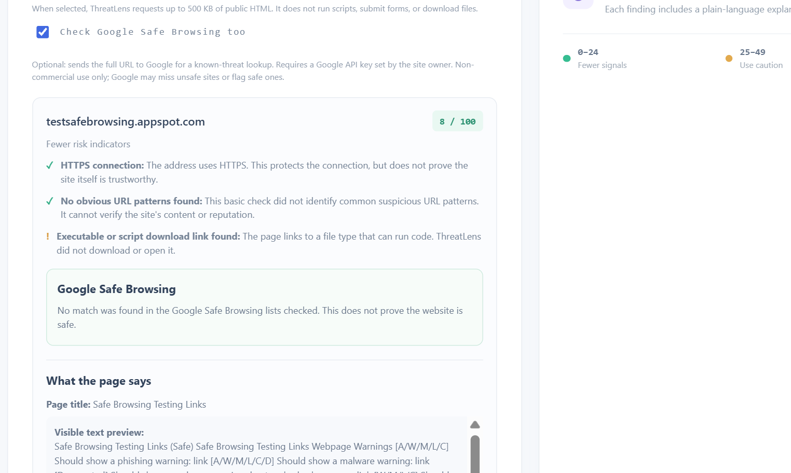
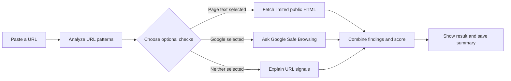

<div align="center">

# ThreatLens

### A clearer way to check a link before you open it.

ThreatLens scans website addresses for common warning signs, can inspect a small amount of public page text, and can optionally check a URL against Google Safe Browsing. Results show the signals behind the score so people can make a more informed choice.

[Open the live app](https://threatlens-security-platform.onrender.com) · [View the source](https://github.com/aqibsolangiali/threatlens-security-platform) · [Open API docs](https://threatlens-security-platform.onrender.com/docs)


</div>

> [!WARNING]
> ThreatLens is an educational warning tool, not antivirus software. A low score or a “no match” from Google does **not** prove a website is safe. A high score does **not** prove it is malicious. Check the signals and verify important links with the organization through a trusted channel.

## Contents

- [See it in action](#see-it-in-action)
- [What ThreatLens checks](#what-threatlens-checks)
- [How a scan works](#how-a-scan-works)
- [Run it locally](#run-it-locally)
- [Configure Google Safe Browsing](#configure-google-safe-browsing)
- [Deploy on Render](#deploy-on-render)
- [API reference](#api-reference)
- [Chrome extension](#chrome-extension)
- [Privacy and security](#privacy-and-security)
- [Project layout](#project-layout)
- [License](#license)

## See it in action

This example uses Google's Safe Browsing test page. The result shows an HTTPS connection, a page-text warning about a code-download link, and Google's response. The “no match” result applies only to the checked Safe Browsing lists; it is not a safety certification.

<p align="center">
  
</p>

[Open ThreatLens](https://threatlens-security-platform.onrender.com) and paste a URL into **Analyze a website link**. Select either optional check if you want it included, then choose **Analyze link**.

## What ThreatLens checks

| Check | What it looks for | When it runs |
|---|---|---|
| URL patterns | HTTP instead of HTTPS, raw IP addresses, encoded internationalized domains, deep subdomains, misleading `@` syntax, unusually long URLs, several hyphens, sensitive wording in the hostname, and uncommon ports | Every scan |
| Limited page text | Page title and description, visible text, password fields, cross-domain form actions, urgent credential wording, and links to executable or script files | Only when **Also inspect page text (limited)** is selected |
| Google Safe Browsing | Whether Google reports a match in the threat lists checked | Only when **Check Google Safe Browsing too** is selected and the site owner configured an API key |

The score is a transparent heuristic, capped at 100. A finding describes a signal to review; it is not a verdict about the site.

| Score | Dashboard label | How to read it |
|---:|---|---|
| 0–24 | Fewer risk indicators | The checks found fewer warning signals. This does not establish trust. |
| 25–49 | Use caution | Review the listed signals and verify the destination. |
| 50–100 | Higher concern | Avoid entering information or downloading files until you verify the link independently. |

## How a scan works



Page inspection reads a bounded amount of HTML; it does not run the target page's JavaScript, submit forms, or download linked files. Google Safe Browsing is an optional separate lookup. The app displays a status if that lookup is unavailable instead of treating it as a clean result.

## Run it locally

### Requirements

- Python 3.10 or newer
- Git (if cloning the repository)

### Start the app

From the repository folder, run:

**Windows PowerShell**

```powershell
py -m venv .venv
.venv\Scripts\Activate.ps1
python -m pip install -r requirements.txt
uvicorn app.main:app --reload
```

**macOS or Linux**

```bash
python3 -m venv .venv
source .venv/bin/activate
python -m pip install -r requirements.txt
uvicorn app.main:app --reload
```

Open <http://127.0.0.1:8000>. Interactive API documentation is at <http://127.0.0.1:8000/docs>.

### Run with Docker

Run these commands from the folder containing the `Dockerfile`:

```bash
docker build -t threatlens .
docker run --rm -p 8000:8000 -v "$(pwd)/data:/data" threatlens
```

Then open <http://127.0.0.1:8000>. The container stores the SQLite database in `/data/threatlens.db`; the mounted folder keeps it between container runs. In Windows PowerShell, replace `$(pwd)` with `${PWD}`:

```powershell
docker run --rm -p 8000:8000 -v "${PWD}/data:/data" threatlens
```

## Configure Google Safe Browsing

The Google check is optional. The person running the hosted service supplies the key; visitors do not need their own key.

1. In Google Cloud Console, select the project where you enabled **Safe Browsing API**.
2. Open **APIs & Services → Credentials** and create an API key.
3. Restrict the key to **Safe Browsing API**. Do not put the key in browser code or commit it to GitHub.
4. In Render, open the `threatlens-security-platform` web service and choose **Environment**.
5. Add an environment variable with key `GOOGLE_SAFE_BROWSING_API_KEY` and the new API key as its value.
6. Save the change and let Render redeploy the service.
7. Open the app, select **Check Google Safe Browsing too**, and scan a test URL.

Google Safe Browsing's API is intended for non-commercial use. Review [Google's usage guidance](https://developers.google.com/safe-browsing/reference/Appropriate.Usage) before using it. When a visitor selects this option, the full submitted URL is sent to Google for the lookup. Google can miss unsafe pages or flag benign ones.

If the result says the lookup could not complete, check the Render **Logs** for an API-key, API enablement, restriction, quota, or network error. The URL-pattern and selected page-text findings still appear separately.

## Deploy on Render

This project includes a Dockerfile. To deploy from GitHub:

1. Push the project to your GitHub repository.
2. In Render, create a **New → Web Service** and connect `aqibsolangiali/threatlens-security-platform`.
3. Select the branch you want to deploy (usually `main`) and the **Docker** runtime.
4. Keep the build context at the folder containing the Dockerfile. If your Dockerfile is at the repository root, use the repository root as the Root Directory.
5. Choose a region and instance plan, then create the service.
6. Add `GOOGLE_SAFE_BROWSING_API_KEY` under **Environment** if you want the optional Google lookup. Keep the value secret.
7. Wait for the deploy to report **Live**, then open the service URL and run a scan.

Render's free instances can spin down when inactive, so the first request after a quiet period may take longer. Check **Logs** if a deploy fails or a requested Google lookup cannot complete.

## API reference

### Scan a URL

`POST /api/scan`

```json
{
  "url": "https://example.com",
  "inspect_page": true,
  "check_reputation": true
}
```

Both optional checks default to `false`. Use `true` only when you intend to request that check. Example with `curl`:

```bash
curl -X POST http://127.0.0.1:8000/api/scan \
  -H "Content-Type: application/json" \
  -d '{"url":"https://example.com","inspect_page":true,"check_reputation":true}'
```

### Other endpoints

| Method | Endpoint | Purpose |
|---|---|---|
| `GET` | `/api/health` | Service health |
| `GET` | `/api/stats` | Scan totals and risk-band counts |
| `GET` | `/api/history?limit=20` | Recent scan summaries |
| `DELETE` | `/api/history` | Clear scan history |
| `GET` | `/docs` | Interactive API documentation |

## Chrome extension

The optional Manifest V3 extension checks the current tab's URL through a local ThreatLens server when you click its action. It is URL-only; it does not inspect the page or block navigation.

1. Start the local app at `http://127.0.0.1:8000`.
2. In Chrome, open `chrome://extensions` and turn on **Developer mode**.
3. Choose **Load unpacked** and select the repository's `extension` folder.
4. Open the extension on a page and run the link check.

The extension's host permission is limited to `http://127.0.0.1:8000/*` by default. A hosted deployment does not automatically change that permission.

## Privacy and security

- URL-pattern scoring runs in the ThreatLens service.
- Optional page inspection makes the service request the submitted public URL. It rejects non-public IP destinations, pins the validated address for the request, follows at most two redirects, limits the response to about 500 KB, and uses a short timeout.
- Page inspection reads HTML text only. It does not execute page scripts, submit forms, or download linked files.
- Selecting Google Safe Browsing sends the full URL to Google. Do not scan private links or URLs containing passwords, session tokens, password-reset tokens, or one-time codes.
- Scan history stores summary information in SQLite. Do not expose a self-hosted instance to people you do not trust without adding authentication, access controls, and an appropriate data-retention policy.
- Use the findings as prompts to verify links independently. HTTPS only protects the connection; it does not establish that the destination is trustworthy.

## Project layout

```text
.
├── app/
│   ├── main.py             # FastAPI service and scan logic
│   └── static/             # Dashboard HTML, CSS, and JavaScript
├── docs/
│   └── screenshots/        # README screenshots
├── extension/              # Optional Chrome extension
├── Dockerfile
├── requirements.txt
├── LICENSE
└── README.md
```

## License

This project is released under the MIT License. See [LICENSE](LICENSE).
